# job-application-assistant 岗位代投助手

**当前版本：v1.19.1 · 2026-10-17**

## 更新日志：v1.19.1 · 公司／BU 用户志愿顺序

- 新增独立“用户志愿”共享表及 user_priorities，公司不分 BU 时统一排序，分 BU 时逐 BU 保存用户确认顺序。
- 官网有序／平行／无志愿机制与用户自身顺序分别记录；已选岗位缺用户确认顺序，或确认依据被修改时阻止交接。
- Excel、整本业务 JSON、批次 JSON 与 HTML 同步包含新维度；旧记录保留并补核分组，不能从推荐次序推断用户决定。
- 验证覆盖公司内重复序号、跨 BU 第一志愿、平行机制独立排序及依据篡改。[Issue #40](https://github.com/SilentLake-Tech-SkillHub/job-application-assistant/issues/40)。

## 更新日志：v1.19.0 · 完整数据与志愿交接

- 搜索端用八张共享表建设公司方案，研究检查覆盖计划、目录、JD、资格、规则、内推和志愿；缺项可追踪，未完成研究不能交接。
- **全部维度结构化**：需求范围、计划要求、岗位/BU/轮次、各层限额、重置、冷冻触发和时长、内推适用范围、志愿、推荐与选择均有对应 Excel/JSON 字段；原文保留为依据，不能替代字段。
- 固定脚本支持原表与明细统一写入、小增量更新、读回和全部批次刷新，减少重复生成整份数据。
- 新增整本 Excel 的完整业务 JSON：所有表、原列、历史行、公式、备注和超链接均保留；批次方案 JSON 继续用于公司审核。
- 志愿独立记录组、岗位、序号、名称、BU/地点；无机制可为空，未知需核查。最终目标必须与确认的志愿一致，不能拿处理次序替代。
- 旧协议可保留事实升级并生成待补检查，重新核对后才能进入表单。详见[固定数据流程](references/storage-workflow.md)与[Issue #36](https://github.com/SilentLake-Tech-SkillHub/job-application-assistant/issues/36)。

## 更新日志：v1.18.1 · Windows 编码修复

- 公司交接 JSON/HTML、草稿输入及中文测试证据显式使用 UTF-8；修复 Windows 默认编码下失败。
- CI 输出使用 UTF-8，报告保存每项退出码和完整输出，中文错误不再中断后续检查。
- 支持“草稿 JSON → Excel → 同版本 JSON/HTML”。数据保存在私有工作簿旁的 `岗位交接/<批次>/`，手动改 Excel 后需重新导出；不依赖后台监听。

## 更新日志：v1.18.0 · 公司方案确认与搜索交接

- 接收搜索端完整公司方案：适用计划、全部岗位名称、三档候选及 JD、最终推荐、用户最终选择、轮次/公司/BU/共享名额及冷冻期、内推查证。
- 用户先核对 HTML，最终选择写回 Excel 并同步 JSON。Excel 是主记录，JSON 是同版本导出，不另建可独立修改的状态台账。
- Prepare、Review、Submit 增加公司方案校验：未确认、版本不同步、该岗未被用户选择、特殊计划未考虑或地区岗位行不一致时阻断。
- 每次追踪表读回成功，自动刷新已建立的公司方案导出；实质变化需要新版本与用户重新确认，既有回执保留。
- 复用搜索阶段已确认的公司选择与次序，Query 只补缺失授权、材料与执行安排。研究确认继续独立于表单审核和最终提交目标批准。

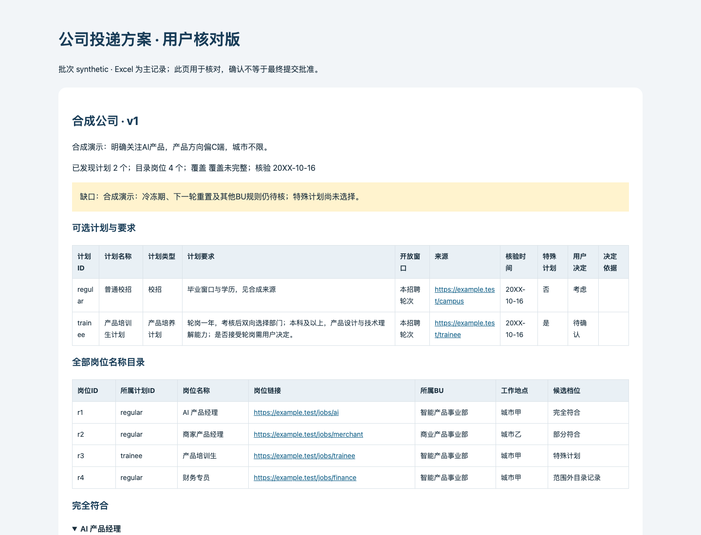

这是导出工具生成的合成页面，用于展示交接格式；不代表任何真实公司规则或用户批准。详见[公司方案契约](references/company-review-handoff.md)与[Issue #34](https://github.com/SilentLake-Tech-SkillHub/job-application-assistant/issues/34)。


## 快速使用：安装、调用与检查

先准备已确认的简历、公司 HTML 核对结果及同版本 Excel/JSON，再确保你的 AI 工具能操作浏览器。旧岗位清单缺少交接方案时，先由搜索端补齐并核对。以 Codex 项目安装为例,在自己的求职工作目录打开终端,执行:

```bash
mkdir -p .agents/skills
git clone \
  https://github.com/SilentLake-Tech-SkillHub/job-application-assistant.git \
  .agents/skills/job-application-assistant
```

已有这个目录时不要重复克隆或覆盖,让 AI 先核对本地修改再更新。安装后重新打开项目或新建对话,下面提示词里的材料和范围替换成自己的实际内容。

**调用整个 Skill**——建议显式写出名称与入口路径,让 AI 按当前任务加载引用和子 Skill,减少只靠自动匹配时漏读内容的情况:

```text
请显式调用 $job-application-assistant,先读取并执行
.agents/skills/job-application-assistant/SKILL.md,按任务加载其中引用和子 Skill。
本批范围是【公司/岗位清单】,使用【简历路径】和【追踪表路径】。
先校验已确认的公司HTML与Excel/JSON，Query只补缺失项，
再按用户最终选择准备表单、保存草稿并交付评审包。
最终提交等我批准具体岗位和评审版本。结尾列出已做、未做、阻塞及证据。
```

**只用其中一项功能**——复制所需的一行给 AI。子 Skill 在库内的 `skills/` 目录中;直接指定文件路径,也适用于工具未单独发现这些子 Skill 的情况。

| 想做什么 | 单独提示词 |
|---|---|
| 处理登录 | 先读取父入口 `.agents/skills/job-application-assistant/SKILL.md`,再调用其中 `skills/application-login/SKILL.md`。仅检查并处理【公司页面】的登录,复用本批有效授权,缺失项先确认;汇报账号核对结果和需要我完成的动作,暂不填写或提交。 |
| 填表与存草稿 | 先读取父入口 `.agents/skills/job-application-assistant/SKILL.md`,再调用其中 `skills/application-content-fill/SKILL.md`。仅用【简历路径】为【岗位页面】准备表单;先核对本批范围、选岗与资格,逐字段填写、读回并保存草稿,给我关键答案、缺失项和保存证据,暂不提交。 |
| 整理个人信息档案 | 读取并执行 `.agents/skills/job-application-assistant/skills/personal-info-vault/SKILL.md`,将我明确提供的【新增或更正信息】记入工作区的私有档案,核对本次改动;档案放在 Skill 目录之外,不公开,暂不操作招聘网站。 |

单独调用只缩小本次任务范围,父流程中适用的范围、资格、授权和审核要求仍然保留。

**检查结果**——每次执行后,可以再发这句:

```text
请对照本次调用的 Skill 和批次记录检查遗漏,按岗位列出:
资格结论及材料缺口;填写是否读回;草稿是否保存并重新读回;
提交是否有官网成功页或申请记录;追踪表是否与官网一致。
每项给出证据,未执行、待我确认和阻塞分别写明。
缺证据的步骤保留未验证,不要将登录、页面已填、按钮点击或脚本通过算成投递成功。
```

接下来是项目的完整介绍与流程说明。

## 版本更新日志：2026-10-15 · 流程优化与 REA 跨投递复用

本次更新在 [PR #29](https://github.com/SilentLake-Tech-SkillHub/job-application-assistant/pull/29) 的 `codex/rea-form-automation` 分支交付，截至本次记录尚未合并。两条路线分别减少普通表单的模型往返，以及重复投递时的复杂控件判断；以下三组数据只衡量相同优化流程下的 REA 学习与复用收益。

### 本地更新方案

1. **程序化准备**：盘点、语义映射、普通字段填写与读回、上传后重扫在程序内连续完成；文档按源哈希加载，模型集中处理例外，REA 按需诊断。
2. **首次学习与保存**：从真实 REA 分析和成功 UI 操作提炼参数化规则，在新空白页重放完整路径，通过当前字段读回和服务端草稿核对后保存。
3. **后续投递复用**：按当前网站范围及表单结构读取验证规则，用当前申请资料和当前控件定位生成新的待填方案；结构失配或读回/绑定失败时使规则失效并回到当前 UI 处理。
4. **保留提交门禁**：规则不携带旧申请值、旧完成状态或批准。每次仍需读回、草稿核对、当前审核版本批准、提交门禁及回执/台账核验。

已有 Git 安装需要体验此 PR 时，在 Skill 仓库目录先运行 `git status --short`，输出为空再按下列步骤更新；有本地修改时先保留并处理，避免覆盖。当前更新目标为 PR 分支。

```bash
git fetch origin
git switch codex/rea-form-automation
git merge --ff-only origin/codex/rea-form-automation
```

更新后重新打开项目或新建对话，显式读取该安装目录中的 `SKILL.md`。默认通道仍为内置浏览器与 Chrome，Playwright 为备用；规则核心和三通道待填方案编译已实现，但生产通道的自动验证晋升仍需接入实际读回/草稿回调，不能将安装更新理解为所有通道已全自动接通。私有档案、原始证据及规则留在私有工作区。接口与接线步骤见[规则复用指引](references/rea-rule-reuse.md)。

### 更新效果：真实模型三组完整测试

同一 **`gpt-5.6-sol / high`**，五类 mock × 三组共 **15 个独立模型回合**；A 保留相同流程优化但禁用 REA/派生规则，B 从空规则库首次学习，C 新上下文只继承对应 B 的验证规则。真实 usage、当前资料、规则来源和提交门禁审计全部通过。

| 组别（各 5 次投递） | 真实总 token | 完整总耗时 | 模型请求 | REA 调用 | 后续规则命中 |
|---|---:|---:|---:|---:|---:|
| A 无 REA（相同流程优化） | 1,134,813 | 362.50 秒 | 38 | 0 | — |
| B 首次 REA 分析＋验证保存 | 1,343,533 | 431.71 秒 | 43 | 5 | 新验证规则 5 份 |
| C 后续验证规则复用 | 824,169 | 325.45 秒 | 30 | 0 | 5/5 |

本轮汇总：首次学习相对无 REA 增加 **18.4% token、19.1% 耗时**；后续复用相对无 REA 减少 **27.4% token、10.2% 耗时**。首次分析与验证有成本，复用减少重复判断；结果不保证每次投递都更快。搜索下拉和日期级联 token 分别减少约 49.1% 和 48.7%，其余三类略增；日期级联复用耗时 110.64 秒，高于无 REA 的 68.25 秒，慢回合完整保留。

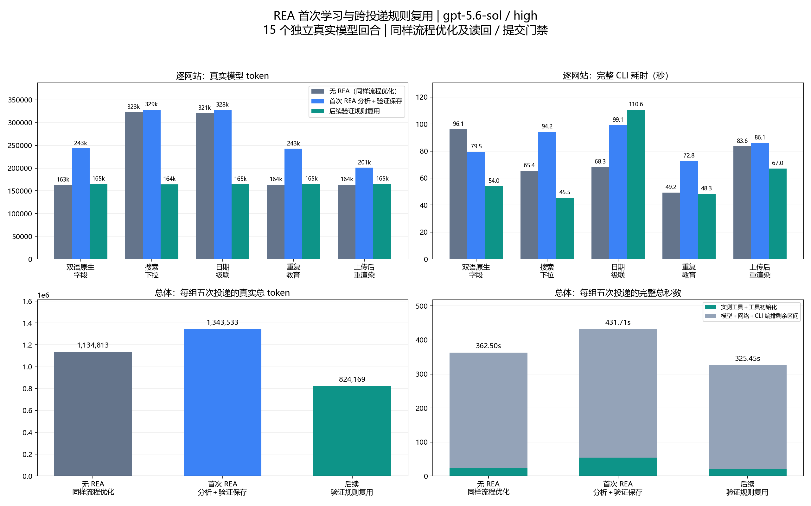

图中展示逐网站三组结果及五站汇总，token 为 CLI 实报 input + output，缓存输入已包含在 input 中；耗时从 CLI 启动至完整退出，包含模型/网络、工具、REA、验证、门禁和失败重试。比例不能换算为金额节省。

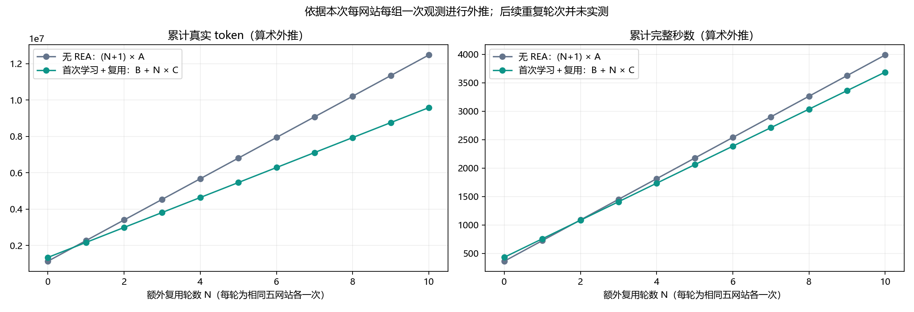

累计图按 `B + N×C` 对比 `(N+1)×A`，每轮为五站各投递一次；本轮数值外推，额外复用 1 轮可抵消首次增加的 token，2 轮可抵消增加的时间。**这是算术预测，不是额外实测或稳定回本保证。**

每网站每组仅一次，提供方缓存及主机负载未控制，本机 CI 与部分实测重叠；不声称统计显著性或单项因果。完整真实模型测试覆盖现有 Playwright 备用适配器，IAB/Chrome 仅验证共享规则编译；人工批准在 mock 中模拟，真实调研、登录、验证码及人工等待未测。未测试“仅 UI 学习并缓存”第四组，不证明 REA 是获得规则的唯一方式。

规则生命周期、失败回退及三通道编译已验证；交付代码 `d084d1b` 的 [Windows/Ubuntu CI](https://github.com/SilentLake-Tech-SkillHub/job-application-assistant/actions/runs/38722322656) 通过 37 个检查入口及五网站真实 REA 学习/复用集成。文档归档的后续提交以 PR 当前 Checks 为准；普通 CI 不调用付费模型。

完整资料：[逐站评估](reports/rea-automation/20261015-rea-reuse/evaluation.md) · [可视化网页](reports/rea-automation/20261015-rea-reuse/dashboard.html)（本地 HTTP 服务打开） · [实施设计](docs/rea-reuse-plan.md) · [最终分析文本](reports/rea-automation/archives/20261015-rea-reuse-final-analysis.txt) · [完整存档 ZIP](reports/rea-automation/archives/20261015-rea-reuse-final-analysis.zip) · [ZIP SHA-256](reports/rea-automation/archives/20261015-rea-reuse-final-analysis.zip.sha256)。存档包含最终结论、原始数值、审计与图表快照及逐文件校验清单，不包含私有原始日志或规则。

### 先前流程优化与历史评测

**程序化表单准备（1.17.0）**：普通字段的盘点、语义映射、输入、逐字段读回与上传重扫在程序内连续完成，AI 只处理例外；同批文档按源哈希只加载一次，REA 仅在正常 UI 探查仍有未知绑定或真实失败时诊断。默认仍为内置浏览器与 Chrome 扩展；Playwright 保持备用角色。批量准备不生成生产批准或提交，现有审核版本、提交门禁和回执台账读回保留。详见[实现设计](docs/rea-automation-design.md)与[执行指引](references/semantic-form-automation.md)。

历史[5 类 mock 配对评测](reports/rea-automation/20261014/evaluation.md)的 token 是交互文本计数；后续[真实模型全链路测试](reports/rea-automation/20261015-full-chain/evaluation.md)记录了实际 usage，并发现旧增强流程增加了请求和耗时。真实 token、文本长度和模型/网络/工具时间分别记录，不能互相替代。

历史[优化前后全链路配对测试](reports/rea-automation/20261015-optimized/evaluation.md)使用同一 `gpt-5.6-sol / high`，两轮均完整传输指令、完成五类 mock 的真实回执与台账读回。实报总 token 为 **1,534,412 → 457,437（减少 70.2%）**，完整耗时 **292.66 → 143.43 秒（减少 51.0%）**，模型请求 **40 → 13**，REA **3 → 0**。这是同一备用执行通道的一次配对结果；缓存输入已包含在总量中，不能解释为金额节省。首次文档被截断的无效尝试及其额外消耗单独保留，未混入正式比较。

补充[原无 REA vs 优化后](reports/rea-automation/20261015-baseline-optimized/evaluation.md)也重新配对执行：**1,112,106 → 417,675 token（减少 62.4%）**，**129.04 → 101.79 秒（减少 21.1%）**，模型请求 **30 → 13**，两轮均 5/5 回执、零次 REA。此改善来自程序化准备及减少模型往返，尚不能证明 REA 诊断的独立收益。报告补齐五网站累计回执时间、共享 usage 曲线及未测项；累计值不是独立单站成本，这份整批数据不隔离单站 cold/warm，后续独立测试见下文。两个配对使用各自重新运行的优化后数据，不混用为同一轮。历史原流程的指令截断已回溯标注，原消耗保留。

[逐站 cold/warm 真实模型测试](reports/rea-automation/20261015-isolated/evaluation.md)另采用 20 个独立模型回合，按 5 类网站、冷/热语义缓存、原无 REA/优化后分别记录完整耗时和真实 usage，恢复分网站四图。warm 仅复用经过真实读回验证的语义结构缓存，丢弃预热页面及已填方案；预热无额外 AI 调用，成本计入完整墙钟并单列。提供方模型缓存与语义缓存分别记录，缺格仍为未测，完整性由独立审计决定；不均摊批次 token，不把模型口头说明当作工具事实。

20/20 格的操作回执、88 个当前字段读回、审核版本、台账与完整文档/usage 对账均通过；每状态下五个独立回合之和如下（相同 `gpt-5.6-sol / high`）：

| 语义缓存状态 | 原无 REA → 优化后真实总 token | 原无 REA → 优化后完整秒数 |
|---|---:|---:|
| cold | 2,337,865 → 1,279,503（减少 45.3%） | 703.29 → 366.45（减少 47.9%） |
| warm | 2,364,289 → 1,106,662（减少 53.2%） | 684.12 → 278.84（减少 59.2%） |

20 回合共报告 7,088,319 token、2,032.70 秒，其中本地预热 10.86 秒已包含；优化后有一次真实 REA（29.31 秒），由搜索字段读回定位不匹配触发后恢复。每格仅一次，仍有无上传控件时的多余探查、空例外调用和模型描述与工具事实不一致等问题，详见报告的质量观察。结果包含提示词理解、模型决策及网络波动，不能把全部差值归因于代码、语义缓存或 REA，也不能换算为同等金额节省。

2022 年,我刚刚进入社会,那一年我投了 70 个简历,最后拿了 10 个 offer。人们都在说"工作不好找"。2026 年,我再次回到校招,发现没有 200-300 次简历投递,很难找到同样的机会;而找工作、投简历本身,就是非常麻烦且复杂的事情。因此,我做了这个。

[`campus-job-skills`](https://github.com/SilentLake-Tech-SkillHub/campus-job-skills) 解决"找"的麻烦:逐家公司收集岗位,整理进 Excel 账本。这个仓库解决"投"的麻烦:你选好一批岗位之后,AI 帮你开页面、登录、填表、存草稿,整理成评审包给你过目;你批准了,才逐个提交,并且只有读到官方回执,才把状态改成"已提交"。面向**中国大陆的校招和实习**。

它能帮你:

- **先问清再动手**:开始前和你确认地区、届别、岗位、地点、时间窗和投递用的简历,以及由一个 AI 还是多个 AI 平行做。
- **两个浏览器并行**:默认同时用 AI 自带的浏览器和你自己的 Chrome(通过 Claude in Chrome 这类插件)分头推进不同公司,同一家公司只在一个浏览器里操作;没有 Chrome 插件时,第二个浏览器自动改用 Playwright(登录一次后会记住);Playwright 没装好时它会告诉你装什么,由你来装。
- **批量填表、断了能接着填**:每个岗位先把表单盘点成一份填写方案(`填写方案.json`),普通输入框成批填写,下拉、日期这类组件照样真实点击,每个字段填完立刻读回。中途断了,从没填完的字段接着来。这份 JSON 只记填写进度;投没投、扫没扫照旧只写在 Excel 里。
- **分组开页、集中登录**:只打开本批已确认的公司;使用 Chrome 时,每个 AI 创建的窗口最多放 10 个网页,第 11 页另开窗口。各家公司推进到登录点后,汇总需要你处理的事项;你登录的同时,它继续推进已登录的公司。
- **先查投递数量规则**:每家公司最多能投几个岗位、能不能同时进行、志愿和变更规则怎么定,查清楚写在确认清单第一行,不会把超过上限的岗位当成都能投。
- **投递前核对任职资格**:按官网完整岗位说明和你的当前材料,分别核对必需条件、优先条件和待解释条件,列出符合、不符合或待核的依据。匹配分和追踪表中的“待投递”都不能代替这一步。
- **按你的简历逐字段填写**:先盘点页面上每个控件是什么,下拉、级联、日期都点真实选项,不靠直接赋值蒙混;简历里没有的信息,一次性问你,并记进你本地的私有档案,下次不再问。
- **评审包**:岗位清单、每份表单的版本、关键答案、未解决的字段和截图,整理好给你过目。
- **提交前再确认一次**:点最终提交之前,把公司、业务集团、办公地、岗位、意向部门逐项摆出来,等你对这个确切目标明确确认。
- **只认回执**:看到成功页或申请记录,才改追踪表。点了按钮、弹出了窗口,都不算成功。
- **多个 AI 平行准备**(可选):公司很多时,经你同意分给多个 AI,各管各的公司和账号,最后一个 AI 统一写追踪表。

所有最终提交都由你确认,任何自动化档位都不例外。

## 最终成品是什么?

每一批投递,你会得到下面这些东西:

| 产物 | 里面是什么 | 什么时候用 |
|---|---|---|
| **评审包** | 本批岗位清单、任职资格结论与证据缺口、每份表单的版本、关键答案、未解决的字段、页面截图 | 批准投递之前,逐个看 |
| **岗位追踪表**(你的 Excel 求职账本,唯一的状态记录) | 扫过的每家公司都有盘点状态(五个标签之一);每个岗位的投递状态从"待投递"改成"已提交",只在拿到回执后改;留空、受阻的原因写在备注 | 随时看这一批扫到哪、投到哪了 |
| **投递证据文件夹**(私有,在你自己的投递目录) | 本批 Query 答复、你的每次确认原话、截图、读回、审核包和回执,按公司和岗位分目录存放 | 对话中断后接着做,核对每一步的依据 |
| **个人信息档案**(私有,只在你本地) | 简历以外的信息,比如家庭所在地、紧急联系人、各公司的偏好 | 填表时直接取用,不用每家重复问 |

追踪表可以直接沿用 `campus-job-skills` 产出的账本。个人信息档案不在仓库里,仓库只提供一个空白模板,放在 [`skills/personal-info-vault/assets/profile-template.md`](skills/personal-info-vault/assets/profile-template.md)。

## 模块与流程

这个仓库由四个模块按顺序工作,另有一个可选的协作模块:先问清这一批的范围和授权,再处理登录,然后按简历填写表单,最后把评审包交给你批准、逐个提交。公司很多时,可以再加上多个 AI 平行。

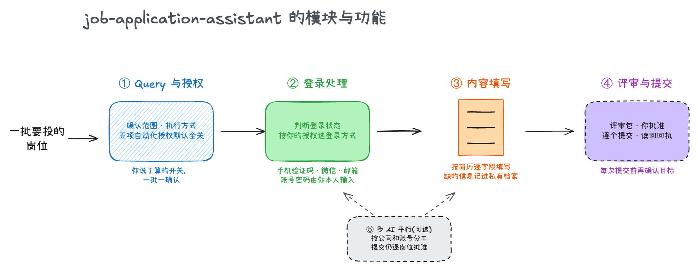

下面逐个讲每个模块做什么、内部怎么走。

### 模块 ① Query 与授权

**它做什么:** 每一批开始前,把范围、执行方式和"哪些事可以自动做"问清楚。

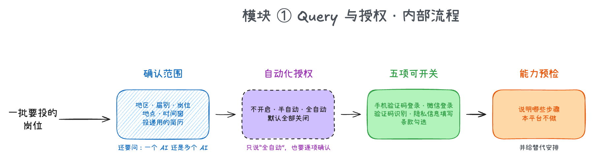

AI 先问清楚这一批的范围,并分成两部分。**硬范围**是明确要排除的边界,比如地区、届别、用工性质和城市。**三条独立的偏好**是就业路径、城市和岗位方向,只决定排序,不会把岗位排除出去,遇到冲突由你取舍。城市不限仍可有城市偏好;并列、弱优先和未决定的关系会按你的原意保留,不会合成一个总分替你选岗。它还会问这一批的**默认岗位次序**,例如 `AI产品 > 产品 > 其他`,每一批都重新问,不沿用上一批。接着问时间窗、投递用的是哪份简历,以及由一个 AI 来做,还是由多个 AI 平行做;搜索阶段选过多 AI,不代表投递阶段也选了,这里要重新确认。

接下来是**自动化授权**。有五件事默认全部关闭,要你在这一批明确开启才会做:手机验证码登录、微信登录、验证码识别、隐私信息填写、条款勾选。你可以一项都不开(这些都由你本人来),也可以只开其中几项(半自动),或者全开(全自动)。你明确选择"全自动"时,五项即已开启,它会说明边界并继续,不会再问一次是否开启。同批续跑或换执行方会读回有效授权,只补问缺失或实质变化的事项。浏览器已预填的已有账号可以点击普通登录并核对结果,不读取、保存或导出密码。短信结果和图形验证默认由你提供或完成;完整接手验证、微信私密截图交接、本次条款全部代勾,各需三次明确确认:范围、风险与最终授权。这是本 Skill 的额外流程,不能替代平台要求的具体协议披露、持续权限逐次确认或本人操作。最后它做一次能力预检,看当前这个 AI 能用浏览器、computer use、系统脚本、Playwright 中的哪些,把它自己所在平台不会做的步骤提前告诉你,并给出替代安排。

### 模块 ② 登录处理

**它做什么:** 判断现在是否已登录、登录的是哪个账号,再按你开启的授权选择登录方式。

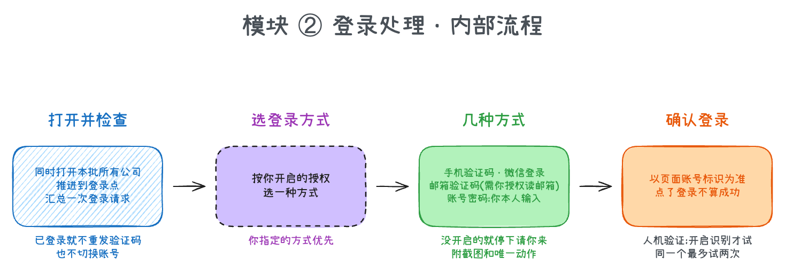

AI 只打开本批已确认范围内需要的页面,优先复用已有公司页。使用 Chrome 时,每个 AI 创建的窗口最多打开 **10 个网页标签页**,第 11 个网页先新建窗口再打开;岗位详情、登录和表单页都计入页数。这个数字控制窗口分组,不限制本批公司数量,也不会为了凑满而增加公司。

每家公司先展示岗位和次序供你确认,再推进到登录点,随后向你发**一次**汇总的登录请求。你登录的时候,它继续推进已经登录好的公司。已登录的页面不会重发验证码或切换账号;未保存表单、草稿、待审核页面、回执和你指定保留的页面会继续保留。需要你完成的步骤会附截图和具体操作,单家公司被卡住时,其他已授权且独立的公司仍可继续。

登录方式有四种:手机验证码、微信登录、邮箱验证码、账号密码。手机登录只在你开启对应授权时由 AI 填号和请求短信,默认由你提供或输入短信码;完整接手还需三次确认、具体短信来源授权和平台允许。微信由 AI 打开入口,三次确认后只在平台允许时把最少截图发到已核验的本人私密渠道,由你扫码或本人授权,AI 不点快捷确认或 OAuth“允许”;邮箱验证码只在你明确授权读取那个邮箱后才用;账号密码不由它代填;浏览器或你已填好的既有账号可以由它点击普通登录并核对结果,缺失或错误时才请你处理。你没开启的方式,它停在那一步,附上截图,告诉你唯一需要做的动作。网站只支持某一种方式时,按网站实际情况来;你指定了方式,就优先用你指定的。

登录过程中的普通验证点击可在已开启的授权内由 AI 完成,图形挑战默认交给你本人;你明确要求完整接手并完成三次确认后,它才在平台允许范围内用 computer use 尝试,同一个验证最多试两次,不行就交还给你。最后以页面上的账号标识为准确认登录成功,点了"登录"本身不算成功。

### 模块 ③ 内容填写

**它做什么:** 按你指定的简历,把表单逐字段填好并存成草稿,不动最终提交。

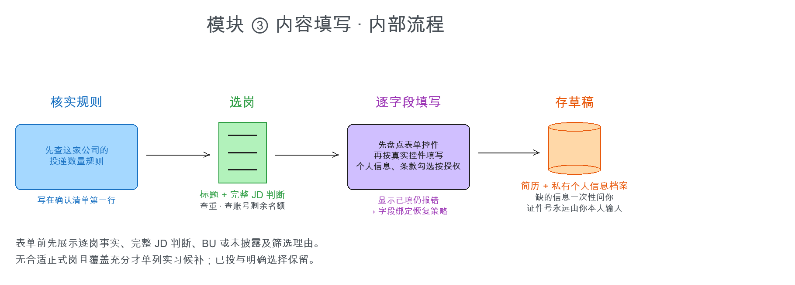

每家公司开始之前,AI 先查投递数量规则:最多能投几个、能不能同时进行、志愿和变更规则怎么定,写在确认清单的第一行。再按“标题加完整 JD”核对职责,并查账号里的申请历史和剩余名额,避免重复。JD 是官网完整岗位说明,BU 是业务集团或招聘业务单元。随后把这家公司的岗位包汇报给你:公司、BU(没披露就写没披露)、办公地、岗位和直达链接,问你相对这一批的默认次序有没有变动。你确认之后才继续,登录成功或上一批的确认都不能代替这一步。这份汇报和后面评审用的是同一份逐岗报告,不会另外再建一份清单。

进入表单、上传材料或填写之前,它会继承搜索阶段的资格记录,结合当前官网 JD 和你确认的简历、私有档案重新核对学历、毕业时间、专业、语言、经验、工作许可、实习时长等实际出现的条件。**必需条件、优先条件和待解释条件分别判断**:材料没写的事实保留待核,优先条件缺少证据只记能力缺口;明确不符合必需条件的岗位不会默认继续。你针对某个具体缺口、使用真实材料尝试的指令会单独保留。逐岗报告列出条件原文、个人材料依据、资格结论和未决问题,已有“待投递”标签或高匹配分不代表可以直接填表。

填表前先盘点页面上所有控件,为每个字段建一张操作表:下拉和级联要打开并点击真实选项,日期用真实日期面板,上传用文件控件。内容默认取自你指定的投递简历,不会擅自换成旧简历或网站自动解析出来的内容。简历里没有的信息,先查你的私有档案,仍然缺失就一次性问你,你回答的当场就写进档案。个人与联系信息只在你开启对应授权时由 AI 来填。条款先问你逐项查看,还是在本次已确认求职范围内全部代勾;全部代勾需三次确认,已覆盖普通项不再逐项问。具体新协议仍按平台要求先披露并取得接受,持续权限逐次确认和本人操作边界保留;身份证号、护照号这类证件号码永远由你本人在页面输入,它不代填、不保存、不复述。

遇到页面显示已填但仍然报必填、值在联动后消失这类情况,它会先核对字段身份,再换实际可用的操作方式恢复,不会靠提交去试错。填好的内容存为网站草稿。

### 模块 ④ 评审与提交

**它做什么:** 把填好的表单整理成评审包给你批准,批准后逐个提交,并只认官方回执。这个模块有两张图:评审,和提交与回执。

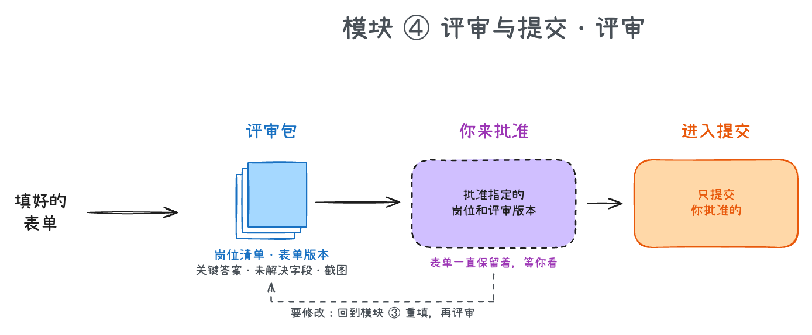

草稿都存好之后,AI 把评审包交给你,按岗位逐个展示:先是公司、岗位和直达链接,再是 BU、城市和用工性质,随后是职责判断、任职资格结论及证据缺口,以及填写、保存、提交各做到了哪一步和对应的证据。只登录不算准备完成,页面显示已填也不等于草稿已保存。另外还有本批岗位清单、每份表单的版本、关键答案、仍未解决的字段和页面截图。实习转正按你在私有配置里的选择处理:选了“转正排最后”,官方明确写了转正机会、且资格和条件经过核对的实习,就和其他岗位放在同一份报告里排在最后。有合适正式岗位时也会保留这些实习候选;转正信息含糊的标待核,不保证转正。表单一直保留在浏览器里,方便你对着看。你批准的是**指定的岗位和评审版本**,不是笼统的"都可以投"。要修改的地方,它回到模块 ③ 改,再给你新版本。

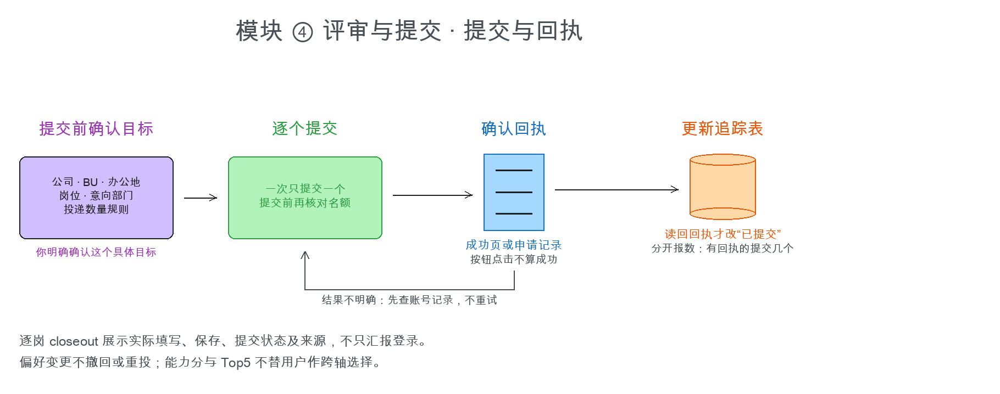

得到你批准之后,每次点最终提交之前,还有一道**提交前目标确认门禁**,下面这张图是它的细节:

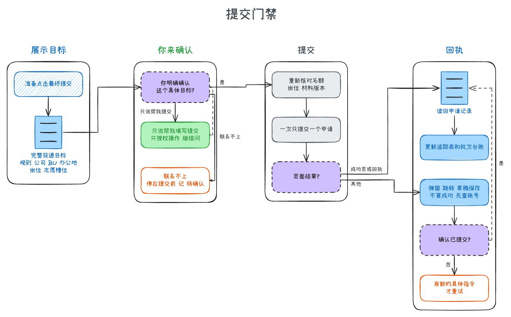

它把投递数量规则、公司与账号、业务集团或招聘主体、办公地、岗位、意向部门或志愿槽位逐项摆给你,等你对这个确切目标明确确认。一句"帮我填写打勾提交"只授权操作,不满足这道门禁;意向部门、志愿顺序这类选择权属于你,AI 只能列出选项和理由,不会替你选。你一时联系不上,它就停在提交前,记成"待确认"。这样做是因为不少网站投递后无法撤回,有的还会让对应业务集团本季不再接收简历,所以这道门禁不会被任何自动化档位覆盖。

确认之后,它一次只提交一个申请,提交前再核对一次名额、岗位和材料版本。提交后以成功页或申请记录为准,读回来之后才把追踪表改成"已提交"。结果不明确时,先查账号里的申请记录,再决定怎么处理,不会直接重试。最后分开报数:查了几家公司、核验了几个岗位、准备了几份表单、有回执的提交几个、有多少是结果不明确或被卡住的。

### 模块 ⑤ 多 AI 平行(可选)

**它做什么:** 公司很多时,经你同意把准备工作分给多个 AI,各管各的公司和账号,最后统一写追踪表。

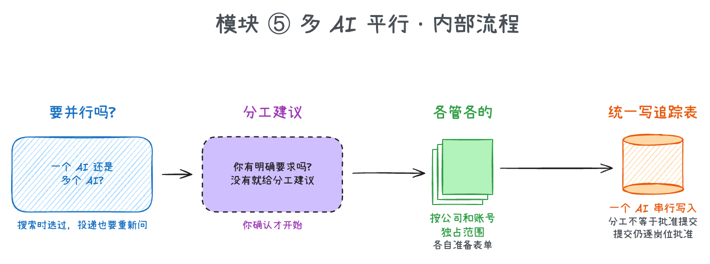

它先问你是一个 AI 还是多个;搜索时选过也要在投递时重新确认。选了多个之后,它会问你对人数、分工、优先级、时间有没有明确要求,没有就给你一份分工建议,你确认了才开始。每个 AI 按公司和账号各管一段独占的范围,各自准备表单;最后由一个 AI 按顺序统一写追踪表,避免同时改同一个文件。每个 AI 交回的结果都带着偏好版本号,和当前版本对不上的会被拒收。分工建议不等于批准提交,提交仍然按岗位逐个确认。

## 我应该准备什么材料?

1. **一份岗位追踪表**(Excel)。没有的话,先用 [`campus-job-skills`](https://github.com/SilentLake-Tech-SkillHub/campus-job-skills) 把岗位收集进来。
2. **一份已确认的投递简历**,以及你的项目集或作品集(如果表单要用)。
3. **复制 Skill,并在你自己的目录里准备私有配置和个人信息档案**(档案从空白模板复制,别放进 Skill 目录)。

然后对 AI 说一句"帮我把这一批岗位准备投递"就行。

## 我可以在哪些工具上使用?

有三种用法,按推荐程度从高到低排列。

### 用法一(最推荐): Codex /  Claude Code + computer use

这是效果最好的一种。把推理强度开到 medium,再打开 computer use(让 AI 直接操作你的电脑和浏览器),登录、填表、上传简历、读回回执它都能做。短信结果和图形验证默认由你提供或完成;你也可以在模块 ① 明确要求完整接手并完成三次确认,让它在平台允许范围内处理。图形挑战用 computer use 尝试,同一个验证最多试两次,不行就交还给你。

**推荐:让 AI 帮你安装。** 把这个仓库交给 AI,说"帮我把这个 Skill 装好"。

**手动安装:**

| 工具 | 复制到 | 装好后的完整路径示例 |
|---|---|---|
| Claude Code | 用户目录 `~/.claude/skills/` | `~/.claude/skills/job-application-assistant/SKILL.md` |
| Codex | 用户目录 `~/.codex/skills/`(或项目里的 `.agents/skills/`) | `~/.codex/skills/job-application-assistant/SKILL.md` |

把整个仓库目录复制过去,目录名用 `job-application-assistant`。里面九个子 Skill(登录、验证码、填写、多 AI 平行等)在 `skills/` 下,跟着一起复制即可。

### 用法二: Cue /  OpenAI Dots,直接挂给个人 Agent

把 Skill 直接挂到你的个人 Agent 上,它做一个、向你汇报一个。适合不想盯着屏幕、只想看进度汇报的人。

### 用法三(可以用,但不推荐): Kimi /  GLM +  Browser use /  Playwright

用 Kimi、GLM 这类模型,搭配 Browser use 或 Playwright 来操作浏览器,也能跑通。但不推荐:这类组合有时识别网页元素不准,模型本身的能力也不强。填表出错的代价比收集岗位更高,所以你在评审阶段要看得更仔细。

## 使用技巧

**怎么指挥 AI**

- **开新一批**:说"帮我把这一批岗位准备投递",它先走模块 ① 向你确认。每一批的选择只对这一批有效,上一批的授权不会自动沿用。
- **自动化授权怎么选**:一项都不开,登录、个人信息、勾选都由你来;半自动只开你放心的几项,其余仍然由你;全自动是五项全开,仍保留各分支的三次确认、平台要求及本人操作。无论哪一档,"最终提交前确认目标"这一步都不会省。
- **公司多的时候用多 AI**:选了多个 AI 之后,它先给你一份分工建议,你确认了才开始;每个 AI 各管各的公司和账号,最后由一个 AI 统一写追踪表,避免同时改同一个文件。分工建议不等于批准提交,提交仍然按岗位逐个确认。
- **对话中断了怎么办**:让它重新读取追踪表、投递证据文件夹、当前材料和网站上的实际状态,先弄清哪些岗位已经提交、哪些结果不明确、哪些资格条件需要补核,再继续。同批有效授权和已确认次序会复用,只补问缺失或发生实质变化的事项。
- **随时补信息**:对话里直接告诉它新的个人信息或偏好,它当场写进你的私有档案。更新偏好时记录新版本,保留已提交结果、明确选岗和你已排除的公司或岗位,只在你指定的缺口内复查;不会重新开始整批搜索,也不会沿用你已经否定的旧值。

**每类产物怎么用**

- **评审包**:逐个岗位核对关键答案和未解决字段,只批准你确认过的版本。
- **追踪表**:筛"待投递"看还剩哪些,筛"已提交"看哪些已经有回执。
- **投递证据文件夹**:出现"结果不明确"的岗位时先看它的岗位目录,再去网站上核对。

## FAQ

**它会自动帮我点提交吗?** 不会。每次点最终提交之前,都要你对这个具体的公司、业务集团、办公地、岗位和志愿槽位明确确认。这一步在任何自动化档位下都不会被跳过。

**实习转正怎么处理?** 由你在私有配置里选:可以不收实习,可以单独成一批,也可以只收官方明确写了转正机会的实习,和其他岗位放在同一份报告里,排在最后。在“转正排最后”的配置下,普通实习不纳入,转正说得含糊的会标成待核;独立实习批次按你确认的范围执行。

**追踪表写了“待投递”,就能直接填表吗?** 还需要核对当前完整 JD 与你的材料,展示独立的资格结论。职责符合范围、能力匹配、任职资格和投递授权分别判断;信息不足时标待核。附带的校验脚本检查批次记录结构,实际资格、草稿保存和提交结果仍靠原文、材料与官网读回确认。

**验证码怎么办?** 普通验证点击可在已开启的授权内由 AI 完成;短信结果默认由你提供或输入,图形挑战默认由你完成。完整接手需三次明确确认,说明范围、验证失败和风控风险,并取得最终授权;短信还需指定来源权限,所有操作都须符合平台要求。图形挑战同一个验证最多试两次,连续弹出验证或提示"操作频繁"时暂停这个网站,先做其他公司,不会换 IP、伪造指纹或换通道绕过限制,也不保存验证码。

**我的身份证号会被保存吗?** 不会。证件号码始终由你本人在页面输入,AI 不代填、不保存、不复述。

**我的个人信息会进仓库吗?** 不会。个人信息档案放在你自己的目录里,仓库只提供空白模板,并且用 `.gitignore` 兜底,档案文件不会被误提交。

**一家公司只让投一个岗位怎么办?** 搜索端先查公司、计划、轮次和 BU 的投递规则并在 HTML 中解释；投递端接收确认后的 Excel/JSON，再读回当前账号名额。可投数量少于你想投的岗位时,会在同一份清单里问你用哪几个。查不到规则时标"未核实",并在第一次提交后立刻读回账号状态,再动这家公司的下一个岗位。

**边界:** 只用你指定的投递简历和你提供的事实,不推断;证件号码和金融账户信息由你本人处理;不保存密码、验证码、Cookie;不撤回、不删除、不重复提交,除非你有新的明确指令;网站状态和追踪表对不上时,先查账号记录,不批量改状态。

## 附录:文件结构

```text
job-application-assistant/
├── README.md
├── SKILL.md                              入口:Query、准备、评审、提交、续跑五个阶段与硬门禁
├── .github/workflows/ci.yml              Linux + Windows 自动跑全部测试
├── hooks/                                提交门禁钩子(Claude Code / Codex / Kimi Code)与安装脚本
├── agents/openai.yaml
├── docs/
│   ├── images/icons/                     README 里的工具图标
│   └── flow/                             模块总览图、各模块的内部流程图、提交门禁细节图
├── references/
│   ├── automation-authorization.md       自动化授权的提问、档位与记录
│   ├── automation-continuity.md          能力预检与连续推进
│   ├── browser-application.md            操作招聘网站的规则
│   ├── chrome-window-grouping.md         Chrome 每窗口10个网页与已有页面保护
│   ├── control-preflight.md              表单控件盘点与操作方案
│   ├── daily-batch.md                    批次 Query 字段与断点续跑记录
│   ├── eligibility-check.md              完整 JD 与当前个人材料的任职资格核对
│   ├── field-binding-recovery.md         字段显示已填仍报错时的恢复策略
│   ├── preference-contract.md            硬范围、独立偏好与逐岗证据规则
│   ├── preference-template.md            私有偏好配置空白模板
│   ├── preparation-scenarios.md          维护用的场景检查
│   ├── stage-contract.md                 入口判定、问题时机、完整交接点清单、状态优先级、收尾检查(唯一出处)
│   └── workbook-contract.md              岗位追踪表的读写约定
├── scripts/
│   ├── chrome_path.cjs                   浏览器测试按系统查找 Chrome/Edge（可用 CHROME_EXECUTABLE 覆盖）
│   ├── inspect_form_controls.js          只读盘点页面控件
│   ├── workbook_state.py                 读取追踪表:盘点状态、投递状态、备注(表结构以 campus-job-skills 为准)
│   ├── evidence_layout.py                投递证据/ 的目录约定与记录解析
│   ├── batch_check.py                    整批一致性、计数与收尾检查(--where 给出证据该放哪)
│   ├── stage_gate.py                     阶段门禁:query / prepare / review / submit / closeout 前必须通过
│   ├── tracker_readback.py               写入追踪表后重开 Excel,对照备份逐行读回
│   ├── ci.py                             一键跑:静态 → 单元 → 冒烟 → 浏览器全流程 → 压力
│   ├── smoke_test.py                     冒烟测试
│   ├── fixtures/synthetic_ats.py         全流程测试用的合成招聘网站(无真实数据)
│   ├── fixtures/sample_tracker.xlsx      campus-job-skills 的样例追踪表(测试用)
│   ├── submit_pass.py                    提交通行证:门禁通过后发放,钩子检查
│   └── test_*                            上述脚本的测试
└── skills/
    ├── application-login/                判断登录状态,按你的授权选登录方式
    ├── login-phone-otp/                  手机验证码登录(需开启)
    ├── login-wechat/                     微信私密截图交接(需开启、三次确认,本人授权)
    ├── captcha-solve/                    图形验证默认交接(完整接手需三次确认)
    ├── privacy-info-fill/                个人与联系信息填写(需开启)
    ├── terms-consent/                    条款逐项查看或本次代勾(后者需三次确认)
    ├── personal-info-vault/              私有个人信息档案规则与空白模板
    ├── application-content-fill/         按简历逐字段填写与读回
    └── application-parallel-execution/   多个 AI 平行准备的协作
```

本仓库由 [SilentLake-Tech-SkillHub](https://github.com/SilentLake-Tech-SkillHub) 维护。

## 证据与提交门禁

状态只写在追踪表里:扫过的公司当场打盘点状态标签,拿到回执当场改"已提交";表格没跟上时,后面每一步的门禁都会拦下。过程证据放在投递根目录的 `投递证据/` 文件夹,按批次、公司、岗位分目录([目录约定](references/daily-batch.md)),你的每次确认也存成文件,纯文字描述一律不认([规则](references/stage-contract.md#10a-严格证据模式与-投递证据))。公司方案 JSON 从 Excel 同版本导出，不能独立编辑；它与表单填写缓存分开管理。

最终提交由平台钩子强制把关:没有先通过提交门禁,浏览器里的"提交 / 投递"点击会被直接拦下。在投递根目录装一次即可([安装说明](hooks/README.md)):

```bash
python <Skill目录>/hooks/install_hooks.py --platform claude-code --project . --write   # 或 codex / kimi
```

## 测试

```bash
pip install openpyxl playwright && python -m playwright install chromium
npm install --global playwright   # 两个 .cjs 浏览器测试用
python scripts/ci.py               # 无浏览器环境: python scripts/ci.py --skip-browser
```

全流程测试 `scripts/test_e2e_full_flow.py` 用 campus-job-skills 的样例追踪表,在本地合成招聘网站上走完一次完整批次:Query → 扫描并打盘点标签(一家可投、一家页面打不开按"留空"处理) → 读数量规则与完整 JD → 资格复核 → 次序确认 → 控件盘点 → 先上传再校正解析 → 真实控件填写 → 保存草稿并重开读回 → 审核包与版本哈希 → 批准 → 目标确认 → 钩子拦截无通行证的提交 → 提交并核验回执与申请历史 → 当场把投递状态改为已提交并读回 → 续跑对账 → 收尾检查。每一步都过对应的阶段门禁,并验证门禁在该停的地方确实拦住。测试只证明流程与工具配合正确,不代表任何真实招聘网站的行为。

## 执行可靠性分析与待修复问题

[2026-10-11 完整分析报告](reports/execution-reliability/20261011/analysis.md)记录投递准备、保存与读回、批次退出，以及 Job Search 和 Harness 的关联缺口；同目录保存公开复现证据。修复由 [Issue #23](https://github.com/SilentLake-Tech-SkillHub/job-application-assistant/issues/23) 跟踪，Harness 配套问题见 [Issue #18](https://github.com/SilentLake-Tech-SkillHub/SilentAgentHub/issues/18)。报告发布和历史版本交付不代表缺陷已修复。
