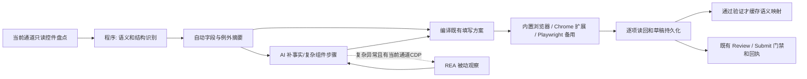

# REA 增强表单自动化设计与验收

设计输入：[分享对话](https://chatgpt.com/share/6ace884a-0c38-83ec-ba2b-8e481bb4e519)，
2026-10-14 已通过内置浏览器完整阅读该页面显示的三轮讨论。实际实现以本仓库的浏览器分工为准。
REA 来源为本机 `REA 逆向工程` checkout，版本 6.4.0，commit
`ed24604ee10362b063feb8610cee1f2049df65c8`。工作分支：`codex/rea-form-automation`。

## 目标与现状

已有 `inspect_form_controls.js` 负责盘点，`profile_vault.py` 负责私有事实，
`fill_plan.py` 负责缓存和跨通道动作清单，`playwright_fill.py` 是 Chrome 扩展缺失时的备用执行器。
默认仍是内置浏览器与 Chrome 扩展两个通道。现有流程已经批量填写，比较基线必须保留这一点。

优化对象是需要 AI 阅读和生成的重复结构。把明确别名、控件分类、分组识别、结构校验、
缓存和编译放进程序；AI 只接收摘要、缺失事实和需要判断的例外。没有把 REA 当成自动理解简历的模型。
不预设浏览器底层点击或填值会变快。

## 三层映射与职责

| 层 | 本次实现 | 复用边界 |
|---|---|---|
| 信息语义 | `form_semantics.cjs` 的确定性中英文别名，输出档案键与置信度 | 姓名、联系方式、项目、显式本科/硕士字段可跨站点复用 |
| 元素定位 | 当前盘点的真实关联 label；重复 label 使用本次 CSS 与教育分组 | 每次重扫，不能复用旧 DOM ID 或按坐标猜位置 |
| 真实操作 | 复用现有 `fill_plan` 动作和各通道表单 API | 原生字段自动；复杂组件先补真实点击步骤、读回位置 |

“最高学历”“学校”缺少明确教育层级时不会自动套用本科或硕士。调剂、志愿、协议、
身份凭据属于例外；不能从旧偏好或模板推导当前授权。重复的“就读院校”通过 fieldset 的
本科/硕士分组识别。无法识别教育条目时，AI 需确认分组，不能按页面顺序编造经历。

## 数据流



`compile_form_mapping.py` 重新用当前盘点和规则验证映射，再调用既有骨架生成器，
使用相同 schema 和隐私约束。现有 `actions`、Playwright、导出、续跑和 Excel 门禁可继续使用。
没有新增岗位状态文件。

## REA 中具体采用的内容

| REA 位置 | 采用方式 | 价值与限制 |
|---|---|---|
| `src/domain/canonicalDigest.ts` | 按 MIT 许可移植纯函数为 `scripts/vendor/rea_canonical_digest.cjs` | 确定性 SHA-256 指纹与缓存承诺；保留来源、commit、许可证 |
| `src/domain/browserObservation.ts` | 桥接入口采用显式 loopback CDP、精确 origin、指定 target | 不枚举或调查无关账号；浏览器必须已经由调用方提供 |
| `src/browser/CdpPageCapture.ts` | 通过 REA CLI 按需调用 `inspect-web-page`，不复制整套 provider | 保持被动观察；不替代任何填写、协议或最终提交操作 |
| `src/domain/browserCompleteness.ts` | 桥接保留 completeness，截断和缺失显式报失败 | 缺证据不能宣称已验证；DOM/AX 观察不等于后端保存 |
| `src/domain/browserScenarioNormalization.ts` | 参考结构归一与承诺设计，未复制该模块 | 只去掉 DOM ID 这类易变定位，不删除字段语义、枚举和约束变化 |
| `src/application/BrowserEvidence.ts` 与 `browserObservationSchemas.ts` | 按公开 Evidence envelope 输出私有原始文件和紧凑诊断摘要 | 不把 DOM 属性名清单误当完整元素定位器，不把网络活动误当 UI 因果证明 |

完整 REA checkout 没有已构建 `dist` 或安装依赖。本次工具默认不构建或携带整套逆向引擎；
需要深度调查时显式指定已安装/构建 REA 的 argv。开发验证安装了 npm 发布的
`rea-agents@6.4.0`，通过真实 CLI/CDP 对独占 mock 浏览器执行被动 capture，验证原始 Evidence、
origin/target 和页面保留。其结果独立保存在 `real-rea-evidence.json` 与 `real-rea-verification.json`，
不混进普通字段 benchmark。原始 checkout 中的 canonical digest 另做了 5 组运行结果一致性核验。

## 缓存与例外

缓存范围是 exact origin + 表单 path + 字段结构 + 规则版本；query 变化不能授权其他岗位。
指纹覆盖字段 label、教育分组、控件类型、只读/禁用、必填、长度/文件限制和原生枚举。
只有本次所有 automatic 字段读回通过后，`verifiedCache` 才能生成缓存。
缓存包含语义键和取值来源，不含个人取值、填写进度、审核许可、回执或岗位状态。

每次仍读取当前盘点并重新生成定位。label 保持稳定时 DOM ID 变化不会迫使 AI 重学；
字段或枚举变化使缓存失效。上传解析和添加经历后重新扫描受影响部分；隐藏、iframe、
shadow DOM 和未渲染步骤按原流程分别检查，不能由空盘点推断不存在。

本次尚不提供任意自定义组件的自动探索，也不把 fixture 中的点击路径当生产平台适配器。
动态搜索选项、级联、日期和未知联动由 AI 在当前 UI 核实后补进既有 `点击步骤`。
这部分可复用既有执行器；首次遇到复杂组件仍可能需要 AI 判断。

## 5 类 mock 与验收

| 模板 | 差异 | 独立验收 |
|---|---|---|
| native-bilingual | 中英文 label、文本、原生学历枚举、联系方式 | 私有来源引用、真实输入事件与服务端草稿 |
| search-dropdown | 同名近似学校，输入不代表选择 | 真实选项 click 才绑定；只输入搜索文字会被服务端拒绝 |
| date-cascade | 省份→学校、只读毕业年月 | 按顺序真实点击；model 与服务端结果一致 |
| repeated-education | 同名“就读院校”的本科和硕士组 | 两个不同来源，不混填，不用 broad label 定位 |
| upload-rerender | 上传清空模型、替换节点并修改 ID | 上传先行、重新扫描再填、附件及新字段读回 |

mock 服务器仅监听 loopback，用合成资料、校验每个预期字段，生成 receipt 并提供读回接口。
另在实际内置浏览器与 Chrome 扩展通道完成两份 mock 草稿并核对服务端读回，证据在
`actual-lane-smoke.json`；这是通道冒烟验证，没有宣称已测量两条通道的投递吞吐。
测试中最终 click 只发生在这台 mock server；生产 mapping/compiler 不生成最终提交步骤。
此外测 stale/edit mapping、缓存字段与 origin 变化、未知字段、隐私授权、三个通道方案契约、
REA 不可用/目标不一致/截断证据等失败路径。既有全流程测试继续验证 Query→Submit→Excel 回执入账。

## 评测方法与 CI/CD

两种情况为“现有批量填写流程”与“程序映射增强流程”；各分首次和已验证缓存，
每个模板每格 5 次，100 次正式计时；warm 的 seed 不计入正式计时。
每对测试交替执行次序。最终报告在 CI 验证结束后单独重跑，避免并行浏览器测试争用机器。
同一执行器、相同 UI 动作、相同保存和 receipt 检查；baseline 的语义判断由固定 mock Agent 代替。

测量包括程序处理、UI、草稿保存与 receipt；不含 browser startup/navigation、模型推理、
用户审核与真实 ATS 网络。token 为保存交互文本的 `o200k_base` 精确计数；不含模型隐藏推理、
system/Skill context、历史重发、provider 封装和缓存计费。真实 usage 默认为 null，可用
`--usage-json` 引入每个 case 的 provider/model/input/output 记录，但必须来自相同 case 的真实调用。
不能把此文本减少比例称为真实模型账单节省，也不能从本地浏览器时长推断真实投递提速。

依赖由 `package-lock.json` 和 `requirements-test.txt` 固定。GitHub Actions 在 Windows 和 Ubuntu
运行既有门禁/静态/单元/冒烟/完整浏览器/压力测试，再跑 5 模板配对 benchmark，保留 JSON、
CSV、交互文本、SVG、PNG、HTML 和评估文档 14 天。不部署到真实招聘系统；发布仍走 PR 合并流程。
CI 的独立步骤安装 pinned REA 测试运行时并执行真实 mock capture；它不成为普通投递流程的自动安装步骤。

```bash
npm ci --ignore-scripts
python -m pip install -r requirements-test.txt
python -m playwright install chromium
python scripts/ci.py
python scripts/benchmark_forms.py --runs 5 --out reports/rea-automation/20261014
```

本次交付与限制见 [评测结果](../reports/rea-automation/20261014/evaluation.md)。

## 真实模型全链路计量（补充）

`scripts/full_chain_benchmark.py` 使用已登录 Codex CLI 启动两个独立新上下文，串行执行现有与增强流程，
各完成同样的 5 类 mock。现有 Skill 文档固定在增强前 commit，增强文档来自本次分支。
两轮使用相同模型与 high 设置，模型实际读取 Skill/档案、决定来源和点击路径；普通字段只在增强轮
交给正式 mapper/compiler。受限 stdio MCP 提供真实浏览器观察、原有输入执行器、门禁、草稿、
提交、回执和 Excel 读回；不向模型提供 fixture 预期答案或点击配方。
增强轮另调用真实 REA CLI，返回其捕获的前端脚本让模型解读。REA 本身没有模型调用。

时间从 CLI 进程启动到完整模型回合及进程退出，另记五份回执和批次门禁全部核验结束时刻。
包含初始化、Skill/档案读取、模型/网络等待、所有工具和错误重试；工具按实际执行时间单列。
总时间扣除工具执行后的剩余时间包含模型、网络和编排，不能声称是纯推理时间。
输入已是确认岗位清单与合成档案，mock 用户审核明确模拟；不虚构登录、验证码、真人等待或求职调研时长。
执行通道为现有 Playwright 备用执行器，不能外推为内置浏览器/Chrome 扩展的完整吞吐。

真实 token 取自 `turn.completed.usage`，并与本轮独立会话的 `token_count` 累计记录交叉核对。
input 含 cached input，output 含 reasoning；总量只加 input + output，缺失项保留 null。
重复累计通知去重，失败回合保留已报告的部分消耗。REA 证据解读计入真实调用总量，不能仅按文本长度
虚构“REA 独立 token”。每种流程一轮只说明本次执行，不能据此宣称稳定平均提速或统计显著性。

```bash
# 手动运行，消耗当前已登录 Codex 账户额度；不属于普通 CI。
python scripts/full_chain_benchmark.py --model gpt-5.6-sol \
  --private test-results/full-chain/manual/private --report reports/rea-automation/manual-full-chain
python scripts/render_full_chain.py reports/rea-automation/manual-full-chain
```

原始 CLI/工具事件留在忽略的 `test-results/**/private/`；公开报告仅保留数字 usage、文档 SHA、合成回执、
时间和评估。CLI 复用登录，不读取/复制凭据，不更改用户全局配置。
普通 CI 只跑离线 usage 解析和真实 mock 控制器用例，绝不自动启动付费 AI。
`gpt-6.1-sol` 曾被本机 CLI 的 ChatGPT 登录接口拒绝；该失败记录单独保存，未返回的 usage 不写成零。
经用户确认，正式两轮改为 `gpt-5.6-sol / high`。

正式 [全链路评估](../reports/rea-automation/20261015-full-chain/evaluation.md) 的结果为：
现有流程 125.71 秒、1,151,884 实报 token；增强流程 179.02 秒、1,464,152 实报 token。
均完成五份真实 mock 回执及台账读回；增强轮三个真实 REA 捕获合计 25.02 秒。
token 总量包括缓存输入，不是新增文本长度或金额。逐请求累计、CLI 回合总量和会话累计记录一致。
本次增强总量增加 27.1%、耗时增加 42.4%，没有实现全链路节省；生产 REA 仍按需使用。
