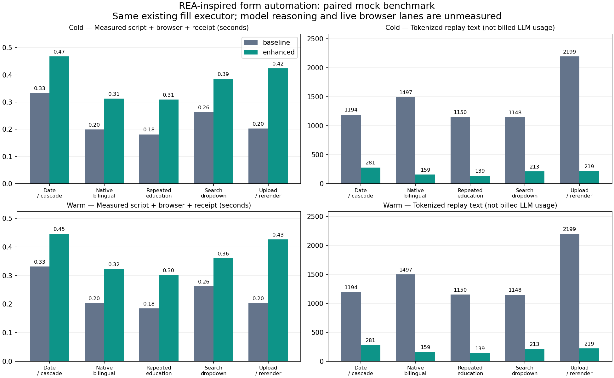

# Mock benchmark evaluation

Generated: 2026-10-14T04:20:30.285215+08:00

100 measured applications; 5 repetitions per site × cache state × mode. All receipts checked against the mock server.

Two cases mean the current batched Skill workflow versus deterministic semantic mapping. Cold/warm are separate strata. Baseline Agent decisions and complex-widget exception decisions are supplied by the synthetic fixture harness; no model was invoked.

| Site | Cache | Baseline seconds | Enhanced seconds | Baseline text tokens | Enhanced text tokens | Text reduction |
|---|---|---:|---:|---:|---:|---:|
| date-cascade | cold | 0.333 | 0.468 | 1194 | 281 | 76.5% |
| date-cascade | warm | 0.331 | 0.446 | 1194 | 281 | 76.5% |
| native-bilingual | cold | 0.199 | 0.313 | 1497 | 159 | 89.4% |
| native-bilingual | warm | 0.204 | 0.322 | 1497 | 159 | 89.4% |
| repeated-education | cold | 0.181 | 0.310 | 1150 | 139 | 87.9% |
| repeated-education | warm | 0.185 | 0.302 | 1150 | 139 | 87.9% |
| search-dropdown | cold | 0.263 | 0.386 | 1148 | 213 | 81.4% |
| search-dropdown | warm | 0.262 | 0.360 | 1148 | 213 | 81.4% |
| upload-rerender | cold | 0.203 | 0.424 | 2199 | 219 | 90.0% |
| upload-rerender | warm | 0.204 | 0.427 | 2199 | 219 | 90.0% |

Values are per-cell medians. Browser timings exclude navigation/startup, model reasoning and user approval. Additional deterministic validation may increase script time; this does not establish a production throughput improvement.

Text token counts use pinned tiktoken/o200k_base on saved replay payloads. They exclude system/Skill context, repeated history, hidden reasoning, provider envelopes and cache billing. Actual provider consumption is null unless independent usage is imported. This run cannot establish billed token savings.

Upload always triggers a fresh inventory. A warm initial cache does not exempt the resulting rerender from validation. Cached assignments never include profile values, role status, final approval or receipts.

The mock harness runs real Chromium UI via the Playwright fallback executor. In-app/Chrome extension live throughput and optional REA deep-diagnostics overhead remain unmeasured. Passing these mocks does not prove a live employer accepts an application.

Raw evidence: `results.json`, `results.csv` and `transcripts/*.json`; input source hashes and environment versions are in JSON. Reproduce with `python scripts/benchmark_forms.py --runs 5 --out <output>`.

